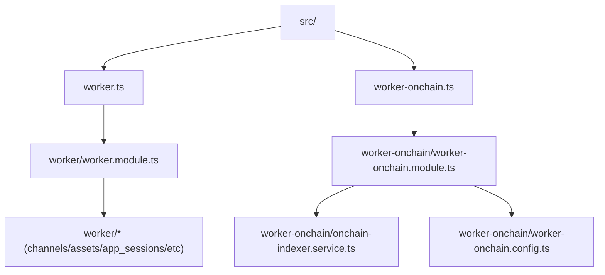
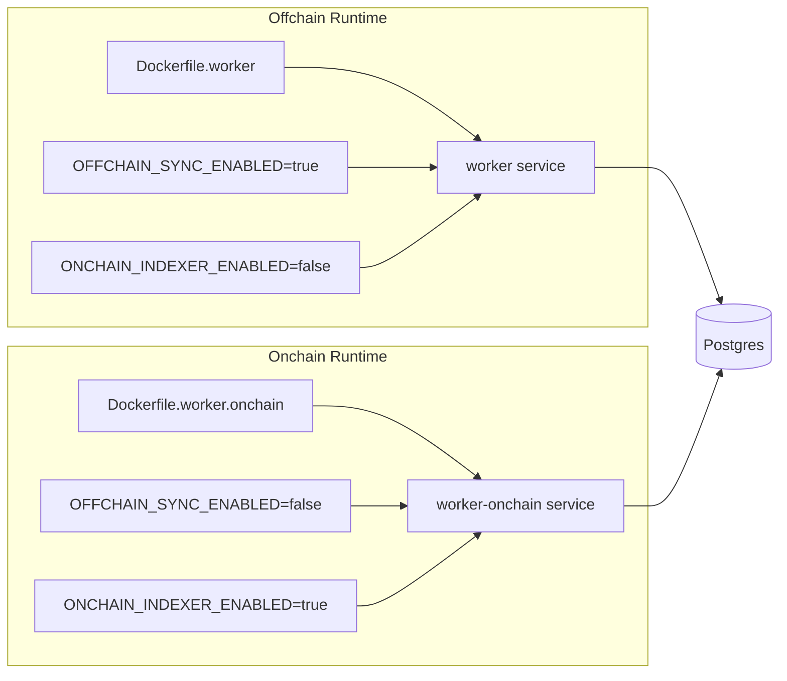
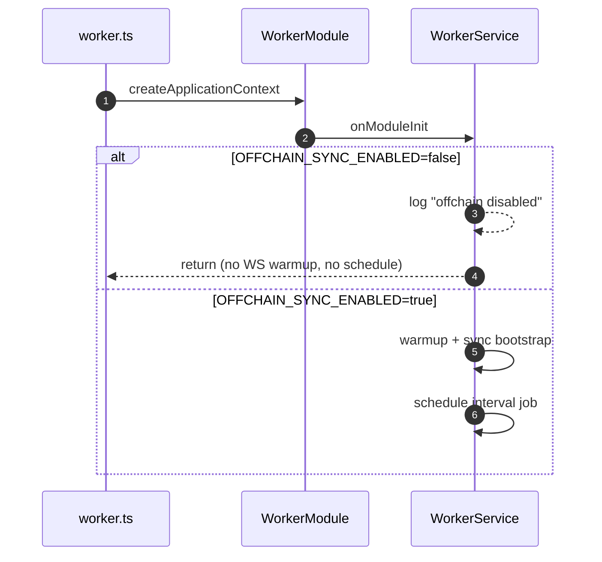

## Worker Split Notes

### What changed

| Area | Final |
| --- | --- |
| Offchain entrypoint | `src/worker.ts` (unchanged role) |
| Onchain entrypoint | `src/worker-onchain.ts` (new) |
| Offchain domain | `src/worker/*` |
| Onchain domain | `src/worker-onchain/*` |
| Offchain image | `Dockerfile.worker` |
| Onchain image | `Dockerfile.worker.onchain` |
| Compose services | `worker` + `worker-onchain` |
| Flag behavior | `OFFCHAIN_SYNC_ENABLED` now enforced in `WorkerService` |

### Diagram 1 - Code Ownership



### Diagram 2 - Runtime (Compose)



### Diagram 3 - Offchain Flag Guard



### Quick run

```bash
npm run start:worker
npm run start:worker:onchain
```
